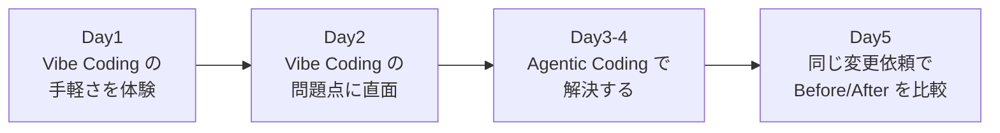

# Agentic Coding 体験研修（5日間）

AI エージェントと一緒にシステムを作る「Agentic Coding」を、**手を動かして体験する**ための5日間の研修です。
教材のベースは、書籍『[Agentic Coding　生成AI時代のシステム開発入門](https://www.sbcr.jp/product/4815636593/)』（渡邉 洋平 著、SBクリエイティブ）です。書籍の内容を網羅するのではなく、体験を通じて「AI にどう委ねればよいか」を身につけることを目的としています。

この研修は**自学自習**で進めます。人間の講師の代わりに **AI チューター**（Claude）が、手順の案内、ミニ講義、画面の確認、振り返りの聞き手を務めます。

AI は**社内で契約している Claude** を使います。Claude は2か所に登場し、役割も会話も別々です。


*   **① AI チューター**：Claude デスクトップアプリのチャットで、社内に共有された研修プロジェクト「AgenticCoding研修」を開くと使えます。Claude in Chrome を通して、Chrome の画面を確認しながら案内します。
*   **② Claude Code（開発の相手）**：GitHub Codespaces の VS Code に入っている **Claude Code 拡張**のパネルから、開発の指示を出します。

道具の使い方は [道具の使い方（はじめに読む）](docs/道具の使い方.md) にまとめています。

> [!NOTE]
> 書籍は Cline と Amazon Bedrock を前提としていますが、本研修では Claude Code に読み替えます（[ClaudeCodeチートシート](docs/ClaudeCodeチートシート.md)）。

## 対象者

*   Git や GitHub は名前を聞いたことがある程度で、アカウントの作成や fork をしたことがない方
*   VS Code やターミナルをほとんど使ったことがない方
*   Coding Agent（Claude Code など）をこれから業務で使い始める方

仕組みを詳しく学ぶ研修ではありません。道具は**使い方だけ**分かれば進められるようにしています。分からないことは、その場で AI チューターに聞いてください。

## 研修のストーリー

この研修は「便利さ → 失敗 → 解決 → 実感」の流れで進みます。座学は各日のミニ講義（30分程度）だけで、残りの時間は手を動かします。



1.  **手軽さを体験する**：雑なプロンプトだけで、数時間でチャットアプリ「Vibe Chat」が完成します。
2.  **問題点に直面する**：Vibe Chat に機能を追加すると、壊れる、直らない、テストもない、という状況に陥ります。問題を自分で検証し、言語化します。
3.  **Agentic Coding で解決する**：要件の具体化、自動テスト、規約の自動化、ガードレールという「4つの作法」を整えます。そのうえで注文管理システム「Vibe Order」を AI と一緒に開発します。
4.  **効果を実感する**：Day2 と同じ種類の変更依頼を Vibe Order に行い、テストと CI が品質を守ってくれることを確かめます。

## 5日間の内容

| Day | テーマ | 主な体験 | 書籍 |
| :--- | :--- | :--- | :--- |
| [Day1](docs/Day1_環境構築とVibeCoding体験.md) | 環境構築と Vibe Coding 体験 | アカウントと Codespaces の準備、Vibe Chat を作る | PART1〜3 |
| [Day2](docs/Day2_VibeCodingの限界とAgenticCodingへの転換.md) | Vibe Coding の限界と転換 | 機能追加で壊れる体験、品質の検証、ガードレールの設定 | PART4 |
| [Day3](docs/Day3_開発基盤構築と要件の具体化.md) | 開発基盤構築と要件の具体化 | モノレポ、テスト、Lint、CI の整備、設計書の作成 | PART5〜6 |
| [Day4](docs/Day4_AgenticCodingで実装.md) | Agentic Coding で実装 | shared、backend、frontend を TDD とセルフチェックで実装 | PART6 |
| [Day5](docs/Day5_仕上げ・BeforeAfter比較・発表.md) | 仕上げ、Before/After 比較、振り返り | E2E テスト、Codespaces での公開、変更依頼の比較、振り返り発表、自己評価 | PART7（読み替え） |

1日分はおよそ7〜8時間です。自分のペースで進めてかまいません。区切りのよいところで中断すると、AI チューターが「再開メモ」を出します。次回はそれを貼れば、続きから進められます。

## 研修環境

| 項目 | 本研修での利用 |
| :--- | :--- |
| AI チューター | Claude デスクトップアプリのチャット（社内共有のプロジェクト「AgenticCoding研修」） |
| ブラウザ | Google Chrome の作業用プロファイル ＋ Claude in Chrome 拡張 |
| Git リポジトリ | GitHub（このリポジトリを各自で fork） |
| 開発環境 | GitHub Codespaces（VS Code） |
| Coding Agent | Claude Code（VS Code 拡張、チャットパネル） |
| AI モデル | 社内契約の Claude |
| 実行環境 | Codespaces 上で起動し、ポート転送で公開 |
| CI | GitHub Actions |

*   アカウントの登録には、すべて**自社のメールアドレス**を使います（作業用の Google アカウント、GitHub アカウント）。手順は Day1 にあります。
*   Codespaces で貼り付けるにはクリップボードの許可が必要です。権限を変更できない他のブラウザ（Claude アプリの内蔵ブラウザなど）では進められないため、Chrome を使ってください。
*   画面が狭いと AI の出力とコードを並べて見られません。可能であれば外部モニターを使ってください。

> [!WARNING]
> **Codespaces の利用枠に注意してください。**個人アカウントの Codespaces には、毎月の無料の利用枠（120 コア時間）があります。この研修の Codespace は 4 コアのため、利用枠は約30時間分です。試走では Day1〜Day2 で約7.5時間を使い、残りは Day3〜Day5 に必要な時間とほぼ同じでした。**無料枠だけでは、受け切る余裕がほとんどありません。**
>
> *   作業を終えるときや長い休憩のときは、https://github.com/codespaces で Codespace の「…」→ **Stop codespace** を押して停止します。「…」のメニューに Stop codespace がなければ、停止しています。
> *   使った時間は、GitHub の右上のアイコン → **Settings** → **Billing and licensing** → **Usage** で、検索欄に `product:codespaces` と入力すると見られます。
> *   残りの時間の目安：（120 − 使ったコア時間）÷ 4 ＝ あと何時間使えるか

## 受講の準備

### 事前に用意されているもの

管理者から配布されます（[管理者向け準備](docs/管理者向け準備.md)）。

*   社内契約の Claude アカウント（自社のメールアドレス）
*   Claude デスクトップアプリ
*   Google Chrome

### AI チューターを開く

AI チューターは、社内に共有された Claude のプロジェクトです。ダウンロードや GitHub アカウントは要りません。ここだけは自分で進めてください。

1.  **Claude デスクトップアプリ**を開き、社内契約の Claude アカウントでサインインします。
    *   Chrome で開く claude.ai（Web 版）ではなく、デスクトップアプリを使います。Web 版では、AI チューターが Chrome の画面を確認できません。
2.  画面上部の切り替えで **チャット** を選びます（Code ではない方）。
3.  左のサイドバーの **プロジェクト** を開き、上部の **組織** タブを選びます。
4.  「**AgenticCoding研修**」を開きます。
5.  プロジェクトの入力欄の下の切り替えが **チャット** になっていることを確認し、「**研修を始めて**」と入力して送信します。ここから先は AI チューターが案内します。

最初に AI チューターから**受講者 ID**（社内メールアドレスの @ より前）を聞かれます。答えたら、案内に従ってチャットの名前を `受講者ID_Day1` のように変えてください。同じプロジェクトを複数の人が使うため、自分のチャットを見分けやすくするためです。

**再開するとき**：同じ日の続きは、プロジェクトの中の同じチャットを開いて続けます。次の日は、プロジェクトで新しいチャットを始め、前の日の最後に AI チューターが出した「再開メモ」を貼り付けて送信します。

## 進め方

1.  AI チューターの案内に沿って、各 Day のドキュメントを進めます。プロンプトや設定ファイルは [hands-on/](hands-on/) からコピーして使います。
2.  毎日の終わりに [日報](docs/worksheets/日報テンプレート.md) を書き、[Vibe vs Agentic 比較シート](docs/worksheets/VibeVsAgentic比較シート.md) を更新します。
3.  最終日に [振り返り発表](docs/worksheets/発表テンプレート.md) と [自己評価](docs/worksheets/自己評価シート.md) を行います。
4.  作成したコードやドキュメントは、自分の fork にコミットして残します。

## リポジトリ構成

```
.devcontainer/          Codespaces の設定（Node.js と Claude Code 拡張）
docs/
  道具の使い方.md       はじめに読む（2つの Claude、VS Code、ターミナル、Git の言葉）
  Day1〜Day5_*.md       各日の研修ドキュメント
  ClaudeCodeチートシート.md
  images/               図
  管理者向け準備.md
  slides/               研修説明用の HTML スライド
  worksheets/           比較シート、日報、振り返り発表、自己評価
hands-on/
  day1〜day5/           コピペ用のプロンプトと設定テンプレート
tutor/
  指示文.md             AI チューターのプロジェクトに設定する指示
  guide/                AI チューター用の日ごとのガイド、トラブル対応、評価
  プロジェクトの作り方.md  研修担当者向け：プロジェクトの作成、共有、更新
  build-knowledge.ps1   プロジェクトのナレッジにアップロードするファイルをまとめる
```

研修中に作成するアプリは、次のディレクトリに置きます。

*   `vibe-chat/`：Day1〜2 の Vibe Coding で作るアプリ
*   `vibe-order/`：Day3〜5 の Agentic Coding で作るアプリ

## スライド

研修の説明用スライドは [docs/slides/agentic-coding-training.html](docs/slides/agentic-coding-training.html) です。研修の概要を人に説明するときや、自分で全体を見直したいときに、リポジトリをダウンロードしてブラウザで開きます。

*   `→` / `Space` / クリックで次へ、`←` で前へ
*   `N` で発表者ノートを表示、`F` で全画面
*   ブラウザの印刷機能で「PDF に保存」すると、全スライドを PDF にできます
