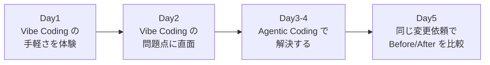

# Agentic Coding 体験研修（5日間）

AI エージェントと一緒にシステムを作る「Agentic Coding」を、**手を動かして体験する**ための5日間の研修です。
教材のベースは [docs/ref/AgenticCoding.pdf](docs/ref/AgenticCoding.pdf) です。書籍の内容を網羅するのではなく、体験を通じて「AI にどう委ねればよいか」を身につけることを目的としています。

> [!NOTE]
> AI は**社内で契約している Claude** を使います。VS Code の **Claude Code 拡張**のチャットパネルから指示を出します。
> 書籍は Cline と Amazon Bedrock を前提としていますが、本研修では Claude Code に読み替えます（[ClaudeCodeチートシート](docs/ClaudeCodeチートシート.md)）。

## 対象者

*   **新入社員**：プログラミングの基礎（変数、関数、Git の基本操作）を学んだ方
*   **AI 駆動開発の入門者**：Coding Agent をこれから業務で使い始める方

## 研修のストーリー

この研修は「便利さ → 失敗 → 解決 → 実感」の流れで進みます。座学は各日のミニ講義（30分程度）だけで、残りの時間は手を動かします。



1.  **手軽さを体験する**：雑なプロンプトだけで、数時間でチャットアプリ「Vibe Chat」が完成します。
2.  **問題点に直面する**：Vibe Chat に機能を追加すると、壊れる、直らない、テストもない、という状況に陥ります。問題を自分で検証し、言語化します。
3.  **Agentic Coding で解決する**：要件の具体化、自動テスト、規約の自動化、ガードレールという「4つの作法」を整えます。そのうえで注文管理システム「Vibe Order」を AI と一緒に開発します。
4.  **効果を実感する**：Day2 と同じ種類の変更依頼を Vibe Order に行い、テストと CI が品質を守ってくれることを確かめます。

## 5日間の時間割

| Day | テーマ | 主な体験 | 書籍 |
| :--- | :--- | :--- | :--- |
| [Day1](docs/Day1_環境構築とVibeCoding体験.md) | 環境構築と Vibe Coding 体験 | Codespaces と Claude Code の準備、Vibe Chat を作る | PART1〜3 |
| [Day2](docs/Day2_VibeCodingの限界とAgenticCodingへの転換.md) | Vibe Coding の限界と転換 | 機能追加で壊れる体験、品質の検証、ガードレールの設定 | PART4 |
| [Day3](docs/Day3_開発基盤構築と要件の具体化.md) | 開発基盤構築と要件の具体化 | モノレポ、テスト、Lint、CI の整備、設計書の作成 | PART5〜6 |
| [Day4](docs/Day4_AgenticCodingで実装.md) | Agentic Coding で実装 | shared、backend、frontend を TDD とセルフチェックで実装 | PART6 |
| [Day5](docs/Day5_仕上げ・BeforeAfter比較・発表.md) | 仕上げ、Before/After 比較、発表 | E2E テスト、Codespaces での公開、変更依頼の比較、チーム発表 | PART7（読み替え） |

1日の時間は 9:30〜17:30（昼休憩 12:00〜13:00）です。開発は個人で行い、最終日にチームで発表します。

## 研修環境

| 項目 | 本研修での利用 |
| :--- | :--- |
| Git リポジトリ | GitHub（このリポジトリを各自で fork） |
| 開発環境 | GitHub Codespaces（VS Code） |
| Coding Agent | Claude Code（VS Code 拡張、チャットパネル） |
| AI モデル | 社内契約の Claude |
| 実行環境 | Codespaces 上で起動し、ポート転送で公開 |
| CI | GitHub Actions |

*   ブラウザは最新の Google Chrome を使い、**Claude in Chrome** 拡張を追加してください（手順は [Day1](docs/Day1_環境構築とVibeCoding体験.md)）。Codespaces で貼り付けるにはクリップボードの許可が必要なため、権限を変更できない他のブラウザ（Claude アプリの内蔵ブラウザなど）では進められません。
*   画面が狭いと AI の出力とコードを並べて見られません。可能であれば外部モニターを使ってください。

## 進め方

1.  このリポジトリを fork し、Codespaces を起動します（手順は [Day1](docs/Day1_環境構築とVibeCoding体験.md)）。
2.  各 Day のドキュメントに沿って進めます。プロンプトや設定ファイルは [hands-on/](hands-on/) からコピーして使います。
3.  毎日の終わりに [日報](docs/worksheets/日報テンプレート.md) を書き、[Vibe vs Agentic 比較シート](docs/worksheets/VibeVsAgentic比較シート.md) を更新します。
4.  作成したコードやドキュメントは、自分の fork にコミットして残します。

## リポジトリ構成

```
.devcontainer/          Codespaces の設定（Node.js と Claude Code 拡張）
docs/
  Day1〜Day5_*.md       各日の研修ドキュメント
  ClaudeCodeチートシート.md
  講師ガイド.md
  slides/               研修説明用の HTML スライド
  worksheets/           比較シート、日報、発表テンプレート
  ref/AgenticCoding.pdf ベース教材
hands-on/
  day1〜day5/           コピペ用のプロンプトと設定テンプレート
```

研修中に作成するアプリは、次のディレクトリに置きます。

*   `vibe-chat/`：Day1〜2 の Vibe Coding で作るアプリ
*   `vibe-order/`：Day3〜5 の Agentic Coding で作るアプリ

## 講師の方へ

事前準備、当日の運営、評価については [講師ガイド](docs/講師ガイド.md) を参照してください。

研修の説明用スライドは [docs/slides/agentic-coding-training.html](docs/slides/agentic-coding-training.html) です。ブラウザで開いて使います。

*   `→` / `Space` / クリックで次へ、`←` で前へ
*   `N` で発表者ノートを表示、`F` で全画面
*   ブラウザの印刷機能で「PDF に保存」すると、全スライドを PDF にできます
