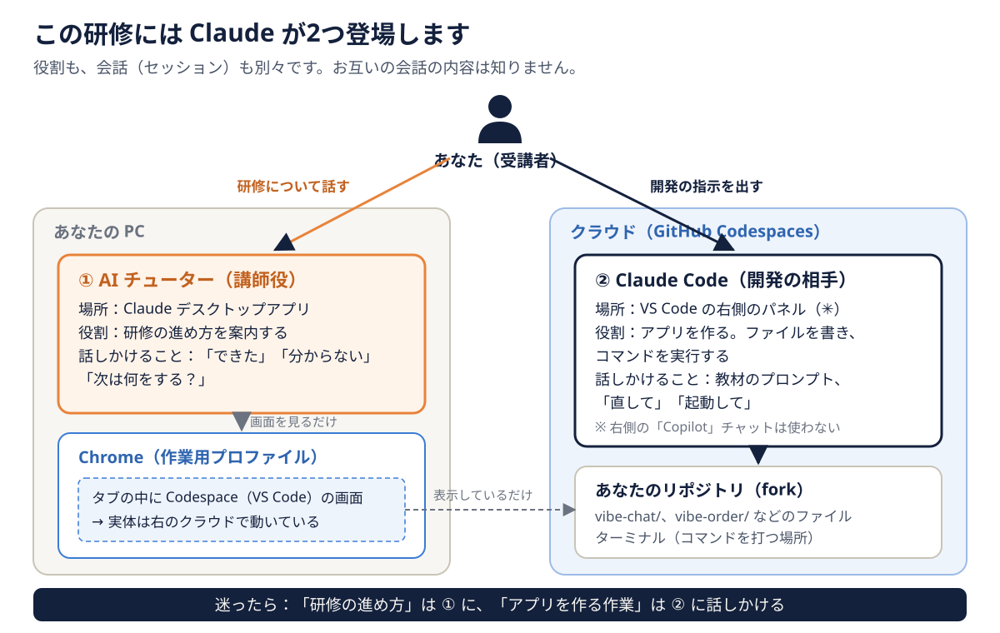
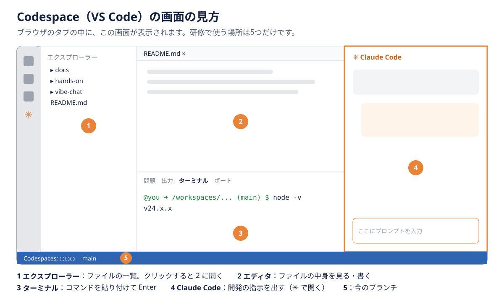

# Day1 環境構築と Vibe Coding 体験

今日は AI エージェントの「すごさ」と「手軽さ」を体験する日です。
コードを1行も書かず、読みもせずに、チャットで指示を出すだけでアプリを完成させます。

> [!NOTE]
> この研修は、**AI チューター**と一緒に一人で進めます。始める前に、[README の「受講の準備」](../README.md#受講の準備)に沿って、Claude デスクトップアプリのチャットで AI チューターのプロジェクトを開いてください。
> 以降の手順は AI チューターが1ステップずつ案内します。操作はすべて自分で行い、結果を AI チューターに伝えてください。

## 今日のゴール

*   作業用の Google アカウント、Chrome プロファイル、GitHub アカウントを用意し、自分の fork で Codespaces を起動できる
*   GitHub Codespaces 上で Claude Code に指示を出せる状態になる
*   Vibe Coding で「Vibe Chat」を作り、ブラウザで動かす
*   AI エージェントが何をどれくらいの速さでできるのか、実感を持って説明できる

## 進め方の目安

| 目安時間 | 内容 | 形式 |
| :--- | :--- | :--- |
| 30分 | オリエンテーション（研修のストーリー、ルール） | AI チューター |
| 20分 | 道具の使い方（2つの Claude、VS Code、ターミナル、Git の言葉） | AI チューター |
| 15分 | ミニ講義：LLM と Coding Agent の要点 | AI チューター |
| 120分 | アカウントと環境の準備、Claude Code への最初の指示 | ハンズオン |
| 15分 | ミニ講義：Vibe Coding とは | AI チューター |
| 180分 | **Vibe Chat を作る**（休憩は各自で取る） | ハンズオン |
| 20分 | 完成した Vibe Chat を AI チューターに見せる | AI チューター |
| 30分 | 日報と比較シートの記入 | 個人 |

## 書籍の該当箇所

*   PART1 LLM ユーザーとしての基礎知識（トークン、モデル、ハルシネーション）
*   PART2 Coding Agent の基礎知識（エージェントループ、コンテキスト）
*   PART3 Vibe Coding を試してみよう

## 道具の使い方

[道具の使い方（はじめに読む）](道具の使い方.md) を、AI チューターと一緒に確認します。特に次の図は、5日間ずっと使います。



*   **① AI チューター**（Claude デスクトップアプリ）には、研修の進め方について話します。
*   **② Claude Code**（Codespace の ✳ パネル）には、アプリを作る指示を出します。
*   2つは別々の会話です。② に送るべきプロンプトを ① に送らないよう、AI チューターの指示の【Claude Code に送る】【ターミナルで実行】【ブラウザで操作】【チューターへ】を見て、送り先を確かめてください。

## ミニ講義のポイント

### LLM と Coding Agent の要点

*   **LLM**：次に来る言葉（トークン）を予測するモデルです。もっともらしい嘘（ハルシネーション）をつくことがあります。
*   **コンテキスト**：LLM が一度に読める情報の量には上限があります。会話が長くなるほど、最初の指示を忘れやすくなります。
*   **Coding Agent**：LLM がツール（ファイルの読み書き、コマンド実行）を使い、「考える → 行動する → 結果を観察する」ループを自律的に回す仕組みです。
*   **Claude Code**：本研修で使う Coding Agent です。社内で契約している Claude を使います。

### Vibe Coding とは

*   **Vibe Coding**：コードの中身を意識せず、「作りたいものの雰囲気（Vibe）」を伝えて AI に委ねる開発スタイルです。
*   本研修では、書籍 PART3 にならって次のルールで行います。
    *   実装は意識せず、自然言語でだけ指示する
    *   AI が提案した内容は**そのまま承認する**
    *   コードは見ない。画面を見て気になる点だけを直させる

## ハンズオン

### 1. アカウントと環境を準備する

> [!NOTE]
> このステップで出てくる言葉（GitHub、リポジトリ、fork、Codespaces）は、[道具の使い方](道具の使い方.md#github-と-git) に一言ずつ説明があります。

アカウントの登録には、すべて**自社のメールアドレス**を使います。AI チューターは手順を案内しますが、登録や入力は代行しません。

#### 1-1. 作業用の Google アカウントを用意する

研修用のブックマークや拡張機能を、普段の環境と分けて管理するためのアカウントです。

*   すでに作業用の Google アカウントを持っている場合は、それを使います。1-2 に進んでください。
*   持っていない場合は、Google のアカウント作成画面で、**Gmail アドレスを新しく作らず、既存のメールアドレス（自社のメールアドレス）を使う**方法で作成します。
    1.  Google のログイン画面で **アカウントを作成** を選びます。
    2.  名前などを入力し、メールアドレスを選ぶ画面で **既存のメールアドレスを使用** を選んで、自社のメールアドレスを入力します。
    3.  自社のメールアドレスに届いた確認コードを入力して、登録を完了します。

#### 1-2. Chrome に作業用のプロファイルを作る

1.  Chrome 右上のプロフィールアイコンから、**追加**（新しいプロファイルを作成）を選びます。
2.  **ログイン** を選び、1-1 の作業用アカウントでログインします。
3.  これ以降、研修の作業はすべて**この作業用プロファイルの Chrome** で行います。

> [!IMPORTANT]
> Claude アプリの内蔵ブラウザなど、サイトの設定（権限）を変更できないブラウザでは、クリップボードの許可ができず貼り付けに失敗します。必ず Chrome を使ってください。

#### 1-3. Claude in Chrome を追加する

1.  作業用プロファイルの Chrome で Chrome ウェブストアを開き、「Claude」（提供元：Anthropic）を検索して追加します。
2.  ツールバーの Claude のアイコンを開き、**社内契約の Claude アカウント**でサインインします。
3.  AI チューターに「Chrome をつないだ」と伝えます。AI チューターが接続を確認します。
    *   これで AI チューターが Chrome の画面を確認できるようになります。AI チューターが見るのは、自分で開いたタブだけです。画面の操作はしません。

#### 1-4. GitHub アカウントを作る

1.  作業用プロファイルの Chrome で github.com を開き、**Sign up** を選びます。
2.  **自社のメールアドレス**、パスワード、ユーザー名を入力して登録します。
3.  自社のメールアドレスに届いた確認コードを入力して、登録を完了します。
4.  ユーザー名を AI チューターに伝えます。

#### 1-5. 研修リポジトリを fork する

1.  研修リポジトリを開き、右上の **Fork** から自分のアカウントに fork します。
2.  fork したリポジトリの URL を AI チューターに伝え、Chrome のブックマークに登録します。あわせて https://github.com/codespaces もブックマークします。

#### 1-6. Codespaces の待ち時間を延ばす

Codespace は、しばらく操作しないと自動で停止します（初期値は30分）。Vibe Coding では AI の作業を待つ時間が長いため、途中で止まらないよう延ばしておきます。

1.  作業用プロファイルの Chrome で https://github.com/settings/codespaces を開きます。
2.  **Default idle timeout** を **120** 分にして、**Save** を押します。
    *   止まったまま放置しても、利用枠は減りません。動いている間だけ減ります。作業を終えるときは、待たずに自分で停止してください。
    *   止まってしまった場合も、作業内容は残っています。https://github.com/codespaces から開き直せば再開できます。

#### 1-7. Codespaces を起動する

1.  fork したリポジトリで **Code → Codespaces** を開き、右上の **…** → **New with options** を選びます。
2.  次のとおり選んで、**Create codespace** を押します。
    *   **Branch**：`main`
    *   **Machine type**：**2-core**
    *   それ以外は、表示されたままでかまいません。
    *   4-core を選ぶと、無料の利用枠の減り方が2倍になります（README の「Codespaces の利用枠」）。
3.  数分待つと、ブラウザ上で VS Code が開きます。
    *   `.devcontainer/devcontainer.json` により、Node.js と Claude Code 拡張が自動でインストールされます。
    *   「recovery mode」の通知が出た場合は、環境の作成に失敗しています。自分で直そうとせず、AI チューターに伝えてください。
    *   1〜2分待っても左端に Claude のアイコン（オレンジ色の ✳）が出ない場合は、Claude Code 拡張が入っていません。左端の **拡張機能** アイコン（四角が4つ）を押し、検索欄に `Claude Code` と入力します。提供元が **Anthropic**（認証済みのマーク付き）の「Claude Code for VS Code」の **インストール** を押します。
4.  「このフォルダー内のファイルの作成者を信頼しますか?」と聞かれたら、**フォルダーを信頼して続行** を選びます。自分の fork なので信頼して問題ありません。信頼しないと「制限モード」になり、ターミナルや拡張機能が使えません。
5.  クリップボードの読み取りを許可します。アドレスバー左のアイコン → **サイトの設定** → **クリップボード** を「許可」にします。初めて貼り付けたときに許可を求められた場合は、そこで「許可」を選んでもかまいません。
6.  画面の各部分の名前を確認します。

    

7.  ターミナル（画面の下側）をクリックし、`node -v` と入力して Enter を押します。表示された結果を AI チューターに伝えます。

> [!IMPORTANT]
> この研修で使う Claude Code は、**Codespace の VS Code に入る Claude Code 拡張**です。claude.ai/code（Web 版の Claude Code）は使いません。

> [!NOTE]
> Codespaces は**クラウド上の隔離された開発環境**です。AI が誤ってファイルを消しても、自分の PC には影響しません。これも書籍 PART4 で学ぶ「ガードレール」の1つです。
> 個人アカウントの Codespaces には、毎月の無料の利用枠があります。作業を終えるときは、https://github.com/codespaces で Codespace を**停止**してください。

### 2. Claude Code にサインインする

ここで使うのは **② Claude Code**（Codespace の中の Claude）です。① AI チューターとは別の Claude で、サインインも別に行います。

1.  VS Code のサイドバー、またはエディタ右上の Claude のアイコン（オレンジ色の ✳）をクリックし、チャットパネルを開きます。
    *   右側に最初から表示されている「チャット」（Copilot）は Claude Code ではありません。使わずに閉じてかまいません。
2.  サインイン方法は、**社内契約の Claude アカウント**を選びます。ブラウザで認証画面が開きます。
3.  メールアドレスでサインインし、表示された画面で **許可（Authorize）** をクリックします。
    *   メールで認証コードが届くとは限りません。許可ボタンだけが表示されたら、そのまま押します。
4.  許可すると、ブラウザに**認証コード**が表示されます。コードをコピーします。
5.  Codespace の画面に戻り、Claude Code のパネルにある認証コードの入力欄に `Ctrl+V` で貼り付けて確定します。
    *   Codespaces はクラウド上の環境なので、ブラウザから VS Code へ自動では戻れません。コードを手で貼り戻す必要があります。
6.  チャット欄に「こんにちは。あなたができることを3行で教えて」と入力し、返事が来れば準備完了です。
    *   Claude の応答は日本語に設定済みです（Codespace の作成時に `~/.claude/settings.json` に `"language": "japanese"` が書き込まれます）。メニューやボタンの表示は英語のままです。
    *   英語で返ってくる場合は、チャットで「応答を日本語にして」と依頼するか、入力欄で `/config` を開き、language を `japanese` にします。

> [!CAUTION]
> 認証コードや、ブラウザのアドレスバーに表示される `code=` を含む URL は、パスワードと同じ扱いです。AI チューターを含め、チャットや他人に共有しないでください。

操作に迷ったら [Claude Code チートシート](ClaudeCodeチートシート.md) を見てください。

### 3. 最初の指示を出してみる（ウォーミングアップ）

入力欄の右下でモードを **Manual** にしてから始めます（最初は Auto になっていることがあります）。話題ごとに、パネル右上の **＋** で新しい会話を始めます。

次のような小さな依頼で、Claude Code の動き方を観察します。

1.  「このリポジトリの README.md を読んで、研修の流れを5行で要約して」
2.  「`hello/` ディレクトリに、現在時刻を表示する Node.js のスクリプトを作って実行して」
3.  ファイルの作成やコマンドの実行の前に、**許可を求めるダイアログ**が出ることを確認します。

観察ポイント：

*   [ ] AI はどのファイルを読んでから答えたか
*   [ ] コマンドを実行する前に何を表示したか
*   [ ] 失敗したとき、自分で原因を調べて直そうとしたか（失敗が起きなければ、Vibe Chat で観察します）

`hello/` はコミットしません。残しておいてかまいません。

### 4. Vibe Chat を作る（Vibe Coding）

1.  パネル右上の **＋** で新しい会話を始め、モードを **Edit automatically** に切り替えます。
2.  [hands-on/day1/vibe-chat.prompt.txt](../hands-on/day1/vibe-chat.prompt.txt) の内容をそのまま貼り付けて送信します。
    *   エディタで開いているファイルは、会話に自動で添付されます。添付が付いていたら **×** で外してから送信します。
3.  AI が技術スタックや計画を提案してきたら、中身を深く考えずに「それでお願いします」と承認します。
4.  コマンド実行の許可を求められたら、そのまま許可します。
5.  エラーが出たら、**エラーメッセージをそのまま貼り付けて**「直して」と依頼します。
6.  「起動して」と依頼し、画面を開きます。
    *   開き方：VS Code の下のパネルの **ポート** タブで、使われているポートの行の **地球儀のアイコン**（ブラウザーで開く）を押します。どのポートか分からないときは、Claude Code に「アクセスする URL を教えて」と聞きます。
    *   2人のユーザーで試すときは、2人目を **シークレットウィンドウ**（`Ctrl+Shift+N`）で開きます。同じウィンドウのタブでは、ログイン状態が共有されて2人になりません。
7.  画面を触って気になるところを、自然言語で直させます（例：「もっとおしゃれにして」「ステータスが表示されない」）。

> [!WARNING]
> 今日は**コードを読まないこと**が研修のルールです。気になっても読まずに、画面の挙動だけで判断してください。
> 明日、この「読まなかったこと」の代償を体験します。

完成したら、ターミナルで次を実行して、今日の成果を保存します。

```bash
git add vibe-chat && git commit -m "Day1: Vibe Chat (Vibe Coding)"
```

### 5. AI チューターに見せる

完成した Vibe Chat の画面を AI チューターに見せ、質問に答えます（何ができて何ができなかったか、驚いたこと、そのまま納品できるか）。

### 6. 記録する

作業中、次の数字をメモしておきます。

*   完成までにかかった時間
*   AI に出した指示の回数
*   エラーを貼り付けて直させた回数

記録は、自分用の比較シートと日報に書きます。最初の1回だけ、ターミナルで次を実行して、自分用のファイルを作って開きます（`自分の名前` は自分の名前に変えてから Enter を押します）。

```bash
cp docs/worksheets/VibeVsAgentic比較シート.md docs/worksheets/比較シート_自分の名前.md && code docs/worksheets/比較シート_自分の名前.md
```

```bash
cp docs/worksheets/日報テンプレート.md docs/worksheets/日報_自分の名前_Day1.md && code docs/worksheets/日報_自分の名前_Day1.md
```

開いたファイルの各項目の「：」のあとに、数字や言葉を書き込みます。書き方に迷ったら、AI チューターが記入例を示します。書いたら `Ctrl+S` で保存し、コミットします。

```bash
git add docs/worksheets && git commit -m "Day1: 比較シートと日報"
```

作業を終えるときは、https://github.com/codespaces で Codespace の「…」→ **Stop codespace** を押して停止します。「…」のメニューに **Stop codespace** がなければ、すでに停止しています。

## チェックポイント

*   [ ] 作業用の Google アカウント、Chrome プロファイル、GitHub アカウントを用意し、fork した
*   [ ] Codespaces で Claude Code に指示を出せた
*   [ ] Vibe Chat がブラウザで動いた（すべての機能でなくてよい）
*   [ ] Vibe Chat をコミットした
*   [ ] 比較シートの Day1 欄を記入した

## 振り返り（日報）

[日報テンプレート](worksheets/日報テンプレート.md) を使って、次の問いにも答えてください。

*   AI に任せて「驚いたこと」は何ですか
*   AI が作ったアプリを、そのままお客様に納品できると思いますか。理由も書いてください
