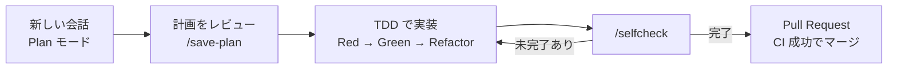

# Day4 Agentic Coding で実装

設計書をもとに、Vibe Order を AI と一緒に実装します。
パッケージごとに「計画 → レビュー → TDD で実装 → セルフチェック → Pull Request → CI」のサイクルを回します。Day1 との違いは、**人が品質のゲートを持っている**ことです。

## 今日のゴール

*   計画、TDD、セルフチェック、CI の開発サイクルを3回まわす
*   shared → backend → frontend の順に実装し、テストとカバレッジ80%以上を保つ
*   コンテキストが長くなったときに、会話をリセットして再開できる

## 進め方の目安

| 目安時間 | 内容 | 形式 |
| :--- | :--- | :--- |
| 15分 | 前日の振り返り | AI チューター |
| 15分 | ミニ講義：TDD、セルフチェック、コンテキスト管理 | AI チューター |
| 15分 | 参照ドキュメント（llms.txt）を取得する | ハンズオン |
| 105分 | **サイクル1：packages/shared** | ハンズオン |
| 135分 | **サイクル2：packages/backend** | ハンズオン |
| 105分 | **サイクル3：packages/frontend**（Day5 の前半まで続けてよい） | ハンズオン |
| 30分 | 日報 | 個人 |

## 書籍の該当箇所

*   PART6 Agentic Coding - コーディング
    *   設計書の分割
    *   shared / backend / frontend の実装計画とセルフチェック
    *   `llms.txt` による最新情報の参照

## ミニ講義のポイント

*   **TDD（テスト駆動開発）**：先に「失敗するテスト」を書かせ（Red）、それを通す最小の実装をさせ（Green）、整理させます（Refactor）。テストが「AI への検証条件」になります。
*   **セルフチェック**：`/selfcheck` で、設計書と実装を突き合わせて AI 自身にレビューさせます。人はその報告と CI の結果を確認します。
*   **llms.txt**：ライブラリの公式ドキュメントを AI 向けにまとめたファイルです。AI の知識が古い場合や、推測で書きそうな場合に参照させます。
*   **コンテキスト管理**：1つの会話が長くなると、AI は初めのほうの指示を忘れやすくなります。パッケージが変わるたびに**新しい会話**を始め、必要なファイルだけを `@` で渡します。

## ハンズオン

### 0. 参照ドキュメントを取得する

権限設定で `curl` を禁止しているため、**自分でターミナルから**実行します。

```bash
bash hands-on/day4/commands/download-llms.sh
```

### 開発サイクル（パッケージごとに繰り返す）



1.  `git switch -c feature/<パッケージ名>` で作業ブランチを作ります。
2.  チャットパネルで**新しい会話**を始め、**Plan モード**に切り替えます。
3.  パッケージ用のプロンプトを送信します。
4.  計画をレビューします。
    *   [ ] 各イテレーションで「先に書くテスト」が決まっているか
    *   [ ] shared の型やスキーマを再利用しているか（重複定義していないか）
    *   [ ] 設計書の受け入れ条件がすべてテストに対応しているか
5.  `/save-plan <パッケージ名>` で計画を保存し、承認して実行させます。
6.  実装中は、AI が**テストを先に書いているか**を観察します。テストを後回しにしていたら指摘します。
7.  実装が終わったら、セルフチェックを実行します。

    ```
    /selfcheck @vibe-order/packages/<パッケージ名>/docs/design.md <パッケージ名>の実装
    ```

8.  自分でもターミナルで確認します。

    ```bash
    cd vibe-order && npm run check && npx vitest --run --coverage
    ```

9.  コミットして push し、Pull Request の CI が成功したらマージします。

### サイクル1：packages/shared

*   プロンプト：[shared-implementation-plan.prompt.txt](../hands-on/day4/prompts/shared-implementation-plan.prompt.txt)
*   主な内容：メニュー、注文、注文状態の Zod スキーマと型、状態遷移のルール（受付 → 調理中 → 提供済）
*   ポイント：状態遷移のルールは、許可される遷移と**許可されない遷移**の両方をテストさせます

### サイクル2：packages/backend

*   プロンプト：[backend-implementation-plan.prompt.txt](../hands-on/day4/prompts/backend-implementation-plan.prompt.txt)
*   主な内容：Hono の REST API、SQLite への保存、seed データ、WebSocket による通知
*   ポイント：
    *   API の入力は shared の Zod スキーマで検証させます
    *   「調理中の注文はキャンセルできない」といった**異常系のテスト**があるかを確認します
    *   起動して `curl` で動作確認したいときは、権限設定に従い自分のターミナルで実行します

### サイクル3：packages/frontend

*   プロンプト：[frontend-implementation-plan.prompt.txt](../hands-on/day4/prompts/frontend-implementation-plan.prompt.txt)
*   主な内容：席の注文画面、キッチン画面、WebSocket の受信と自動再接続
*   ポイント：
    *   backend と frontend を起動し、Codespaces の **PORTS** タブから画面を開いて確認します
    *   席の画面とキッチン画面を別タブで開き、リアルタイムに反映されるかを確認します

> [!TIP]
> 会話が長くなって AI の動きが怪しくなったら、新しい会話を始めて [resume.template.prompt.txt](../hands-on/day4/prompts/resume.template.prompt.txt) で再開します。
> 前の会話の最後に「ここまでの完了報告と残作業をまとめて」と依頼しておくと、スムーズに再開できます。

## チェックポイント

*   [ ] shared、backend の Pull Request が CI 成功でマージされた
*   [ ] frontend の実装を開始した（Day5 の前半に完了すればよい）
*   [ ] カバレッジが80%以上
*   [ ] `vibe-order/docs/plans/` に各パッケージの計画が保存されている

## 振り返り（日報）

*   AI がテストを先に書かなかった、または設計とずれた実装をした場面はありましたか。どう気づき、どう直させましたか
*   Day1 の Vibe Coding と比べて、自分の役割はどう変わりましたか
